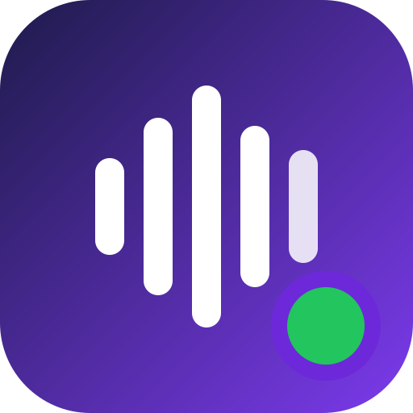
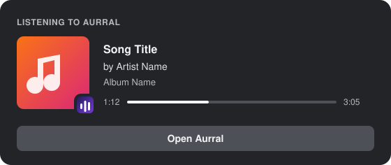
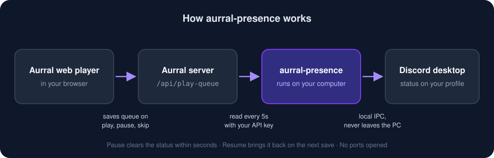

<p align="center">
  
</p>

<h1 align="center">aurral-presence</h1>

<p align="center">Discord Rich Presence for <a href="https://aurral.org">Aurral</a>. Shows the track you are playing on your Aurral server in your Discord status, with album art and a progress bar.</p>

<p align="center">
  
</p>

## How it works

<p align="center">
  
</p>

Aurral's web player (including music.aurral.org) saves your play queue to the server. This app reads it from `GET /api/play-queue` with your personal API key and passes the current track to the Discord app on the same computer. It only makes outgoing requests: nothing is hosted and no ports are opened.

- **Pause:** the player saves straight away, so the status clears within a few seconds.
- **Resume:** the player saves at most every 30 seconds while playing, so after a short pause the status can take up to about 30 seconds to come back. [lklynet/aurral#2229](https://github.com/lklynet/aurral/pull/2229) makes the player save on resume, which brings this down to a few seconds.
- **Close the player:** the status clears within about 40 seconds.

## Setup

1. Create an application at the [Discord developer portal](https://discord.com/developers/applications) with **Create blank app**. Its name is what Discord shows after "Listening to", so name it `Aurral`. Copy the Application ID from General Information. Optionally upload [`assets/logo.png`](assets/logo.png) under Rich Presence > Art Assets with the name `aurral`; it is the cover shown when no album art is found.
2. In Aurral, open Settings > Profile > API access and create a key. Use your own key, not the instance `AURRAL_API_KEY`: playback is per user.
3. Put the secrets in `.env`:

   ```sh
   cp .env.example .env
   ```

4. Adjust `config.json` to taste, then run it with Discord desktop open. Discord in a browser can't receive Rich Presence, and **Settings > Activity Privacy > Share your detected activities** must be on.

   ```sh
   cargo run --release
   ```

## Secrets (`.env`)

| Variable | Purpose |
| --- | --- |
| `DISCORD_CLIENT_ID` | Discord application ID |
| `AURRAL_URL` | Aurral server URL |
| `AURRAL_API_KEY` | Your personal Aurral API key |

## Customization (`config.json`)

Every field is optional; missing ones use the defaults below. Unknown keys are rejected so typos surface at startup.

```json
{
  "pollIntervalSecs": 5,
  "showTimestamps": true,
  "activity": {
    "type": "listening",
    "statusDisplay": "details",
    "name": "Aurral",
    "details": "{title}",
    "state": "by {artist}",
    "largeText": "{album}"
  },
  "images": {
    "showArtwork": true,
    "fallback": "aurral",
    "small": null,
    "smallText": null
  },
  "buttons": [
    { "label": "Open Aurral", "url": "https://music.aurral.org" }
  ]
}
```

| Field | Default | Purpose |
| --- | --- | --- |
| `pollIntervalSecs` | `5` | Seconds between checks |
| `showTimestamps` | `true` | Elapsed / remaining progress bar |
| `activity.type` | `listening` | `listening`, `playing`, `watching`, `competing` |
| `activity.statusDisplay` | `details` | Member-list text: `name`, `state`, `details` |
| `activity.name` | app name | Overrides the activity name |
| `activity.details` | `{title}` | First line |
| `activity.state` | `by {artist}` | Second line |
| `activity.largeText` | `{album}` | Cover hover text |
| `images.showArtwork` | `true` | Look up album art on the iTunes Search API |
| `images.fallback` | `aurral` | Cover when no art is found: asset key or URL |
| `images.small` / `images.smallText` | none | Small badge image and hover text |
| `buttons` | none | Up to two `{ "label", "url" }` buttons |

Templates accept `{title}`, `{artist}`, `{album}` and `{duration}`.

Artwork lookups send the artist and album name to Apple's public search API. Set `images.showArtwork` to `false` to keep everything on your server. Aurral's own cover URLs need your API key, so they are never sent to Discord.

## Notes

- Playback from third-party Subsonic apps shows up only if the app syncs its play queue to the server.
